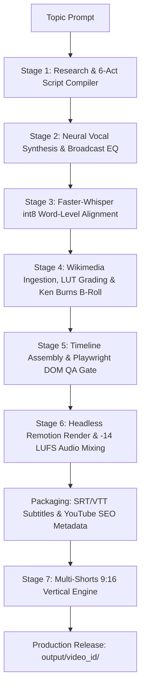

# Vexloci // Forensic Video Engine

[](LICENSE)
[](#installation--prerequisites)
[](https://remotion.dev)
[](#verification--testing)

> **Autonomous AI-Driven Investigative Documentary & Multi-Shorts Production Compiler**

Vexloci is an end-to-end autonomous video production engine designed to compile broadcast-quality forensic documentaries on technological disasters, cyber heists, financial collapses, and institutional crimes. Given a single topic prompt, the engine orchestrates research, multi-act scripting, neural voice synthesis, Whisper word alignment, public domain archival asset harvesting, 2.5D Ken Burns animation, 1080p60/1080p30 Remotion canvas rendering, sidechain audio ducking, and complete YouTube distribution packaging.

---

## Key Highlights

- **Hardcoded 8–12 Minute Long-Form Documentaries:** Generates a universal 24-scene forensic arc across 6 acts (~1,250–1,450 words) delivering 9.5 to 11.2 minutes of immersive narrative runtime.
- **Hardcoded 30–60 Second Vertical Shorts (9:16):** Automatically produces 3 vertical 1080x1920 shorts per documentary, combining multi-scene sequences with mobile-safe kinetic captions and bottom call-to-action banners that drive viewers to the full investigation.
- **Enterprise Broadcast Audio Mastering:** Edge-TTS / Kokoro neural voiceover mastered with 6-band parametric EQ, multiband compression, and `-14 LUFS` sidechain ducking over an atmospheric dark synth score.
- **Full YouTube SEO & Metadata Distribution:** Compiles 3 high-CTR title variations, chapter timestamps, 30+ SEO tags, hashtags, pinned comments, and photorealistic **Nano Bana 2 Pro** thumbnail prompts for both 16:9 and 9:16 aspect ratios.
- **Whisper Subtitles (.srt & .vtt):** Timecoded closed captions grouped into natural 4–7 word phrases for both the long-form video and every individual short.
- **Zero Decorative Jargon:** Clean, dark forensic visual aesthetic inspired by technical terminal feeds, unsealed judicial evidence dockets, and financial autopsy ledgers.

---

## Output Architecture

Every documentary compiled by Vexloci produces a self-contained, modular package inside `output/<video_id>/`:

```
output/<video_id>/
├── long_form/
│   ├── video.mp4                 # 1080p30 16:9 Full Forensic Documentary
│   ├── audio.wav                 # Mastered Vocal Track (48kHz PCM WAV)
│   ├── subtitles.srt             # Timecoded SubRip Closed Captions
│   ├── subtitles.vtt             # WebVTT Closed Captions (HTML5 standard)
│   ├── youtube_metadata.json     # Machine-readable distribution metadata
│   └── youtube_metadata.txt      # Ready-to-copy Titles, Description, Chapters, Tags & Thumbnail Prompts
├── shorts/
│   ├── short_01/                 # Act 1 Hook Short (Peak Incident Cut, 30s-60s)
│   │   ├── short.mp4             # 1080x1920 Vertical 9:16 Video (Kinetic Captions + Bottom CTA Bar)
│   │   ├── audio_slice.wav       # Synchronized Audio Stem
│   │   ├── subtitles.srt         # Synchronized Short Subtitles
│   │   ├── subtitles.vtt         # Synchronized WebVTT
│   │   └── metadata.txt          # Title, Description, Hashtags & Pinned Comment
│   ├── short_02/                 # Act 2/3 Technical Flaw & Breach Short (30s-60s)
│   └── short_03/                 # Act 5/6 Liquidity Collapse & Balance Sheet Short (30s-60s)
├── assets/                       # Wikimedia photos, 35s Ken Burns b-rolls & 2.5D subject cutouts
└── timeline/                     # Compiled 6-act scripts, word alignments, and layout manifests
```

---

## 7-Stage Production Pipeline



### Stage 1: Research & Universal Script Compiler (`pipeline/stage1_research.py`)
Deconstructs any topic in the forensic/cyber/financial collapse niche into a structured 6-act progression:
1. **Act 1: The Cold Open & Anomaly Discovery** (Scenes 1–4)
2. **Act 2: The Architectural Flaw & Infiltration** (Scenes 5–8)
3. **Act 3: The Zero-Hour Execution & Cascade** (Scenes 9–12)
4. **Act 4: Global Contagion & Intercepted Signals** (Scenes 13–16)
5. **Act 5: Financial Plunge & Liquidity Collapse** (Scenes 17–20)
6. **Act 6: Forensic Autopsy & Institutional Legacy** (Scenes 21–24)

### Stage 2: Neural Vocal Synthesis & Mastering (`pipeline/stage2_audio.py`)
Synthesizes vocal tracks via Edge-TTS (`en-US-ChristopherNeural`) or local Kokoro ONNX, normalizes technical strings and financial notations, and applies a 6-band broadcast vocal chain.

### Stage 3: Forced Word Alignment (`pipeline/stage3_align.py`)
Employs Faster-Whisper (`tiny.en` int8 on CPU) to extract millisecond-accurate word boundaries for kinetic on-screen caption highlights and subtitle cue generation.

### Stage 4: Asset Fetch, Ken Burns & 2.5D Layer Splitting (`pipeline/stage4_assets.py`)
Queries Wikimedia Commons and MediaWiki APIs for public-domain historical images, applies OpenCV dark forensic LUT grading, generates 35-second Ken Burns motion clips via FFmpeg, and executes 2.5D background/foreground layer segmentation using `rembg`.

### Stage 5: Timeline Compilation & DOM QA Gate (`pipeline/stage5_compile.py`)
Assigns visual components across 10 specialized Remotion templates (`ForensicDocument`, `TerminalReplay`, `MarketCrashChart`, `NetworkTopology`, `SplitAutopsy`, `SystemBlueprint`, `GeoIpTraceMap`, `CommsIntercept`, `ChronoTickingClock`, `ArchivalFootage`) and runs an automated Playwright DOM verification gate.

### Stage 6: Headless Remotion Render & Sidechain Ducking (`pipeline/stage6_render.py`)
Renders 1080p video frames via Remotion CLI (`MainForensicComposition`), loops atmospheric dark ambient background score, sidechain ducks background music by 3.2:1 whenever narration is active, and masters audio to `-14 LUFS`.

### Stage 7: Multi-Shorts Production Engine (`pipeline/stage7_shorts.py`)
Extracts 3 multi-scene packages bounded strictly between **30 and 60 seconds**, renders vertical 1080x1920 compositions via `ShortForensicComposition`, overlays kinetic captions in the mobile-safe lower-third, and embeds a bottom call-to-action banner.

---

## Installation & Prerequisites

### Prerequisites
- **Operating System:** Windows 10/11, macOS, or Linux
- **Python:** 3.11+
- **Node.js:** 18+ (with npm)
- **FFmpeg:** Installed and available on system `PATH`
- **uv:** Recommended Python package manager (`pip install uv` or `winget install astral-sh.uv`)

### Setup
```bash
# 1. Clone repository and navigate to workspace
git clone https://github.com/Minhaj009/vexloci.git
cd vexloci

# 2. Install Python dependencies via uv
uv sync

# 3. Install Node & Remotion dependencies
npm install

# 4. Verify system toolchain
uv run python -c "import torch, cv2, rembg; print('Python toolchain OK')"
npx tsc --noEmit
```

---

## Running with Custom Research or Topics

Vexloci can run in fully autonomous mode from a single topic string, or ingest custom investigative dossiers formatted as Markdown files.

### 1. Compile from a Topic String
To trigger the automated research and compilation pipeline:

```bash
# Set PYTHONPATH and run master orchestrator
export PYTHONPATH="." # On Windows PowerShell: $env:PYTHONPATH="."
uv run python run_engine.py --topic "The 2012 Knight Capital $440M Trading Glitch" --video-id "knight_capital_glitch"
```

### 2. Reference Investigative Case Files (`examples/demo_story/`)
A fully structured investigative case file is provided at [`examples/demo_story/research.md`](examples/demo_story/research.md). It demonstrates how to format:
- Chronological incident timelines with millisecond/second timestamps
- Technical code defect breakdowns and system architecture blueprints
- Verified financial casualty figures and balance sheet impacts
- Regulatory enforcement references (SEC, FINRA, CFTC dockets)

You can craft custom investigative research files following this format and provide them to your workflows.

### CLI Arguments
| Flag | Description | Default |
| :--- | :--- | :--- |
| `--topic` *(required)* | Topic headline (e.g. `"The 2012 Knight Capital $440M Trading Glitch"`) | None |
| `--video-id` | Custom folder name under `output/<video_id>/` | Auto-slugified from topic |
| `--no-shorts` | Skip rendering vertical 9:16 shorts | `False` |
| `--skip-existing` | Reuse existing stage artifacts in `runs/<video_id>` to accelerate resume | `False` |
| `--api-key` | Optional Gemini/OpenAI API key for dynamic Wikipedia research crawl | `None` |

---

## Verification & Testing

Run unit tests and static typechecking:

```bash
# 1. Run Python unit test suite
export PYTHONPATH="." # On Windows PowerShell: $env:PYTHONPATH="."
uv run python -m unittest tests/test_endscreen_outro.py tests/test_metadata_and_subtitles.py tests/test_storytelling_framework.py

# 2. Verify Remotion & TypeScript schemas
npx tsc --noEmit
```

---

## License & Fair Use
The software and engine code are licensed under the [MIT License](LICENSE). Archival assets retrieved dynamically via MediaWiki are subject to their respective Creative Commons or Public Domain licenses. Documentaries compiled by this engine are designed for educational, investigative, and historical analysis purposes under fair use guidelines.
