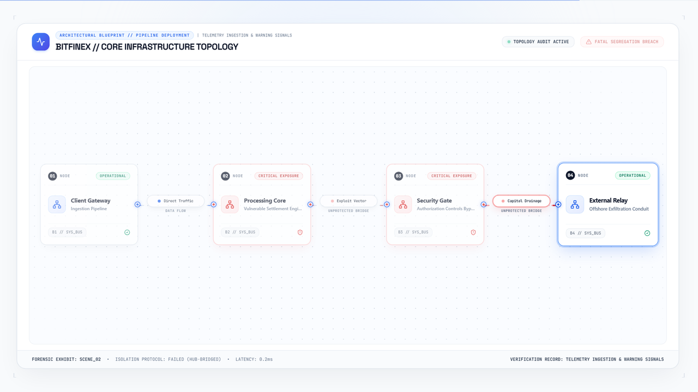
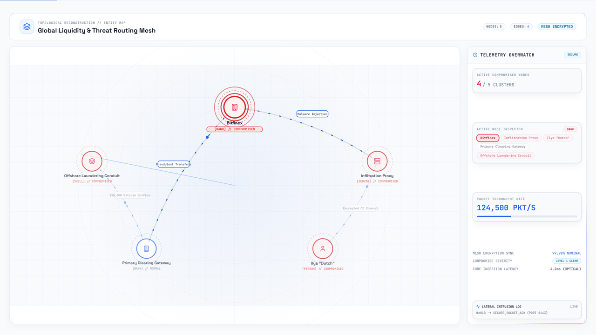
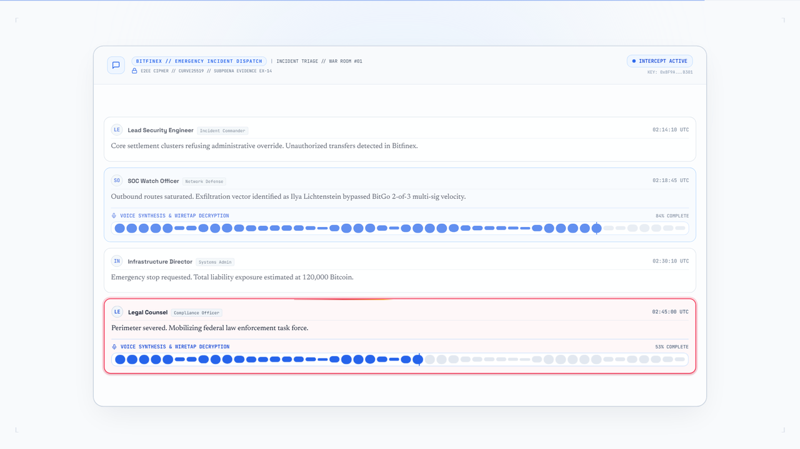
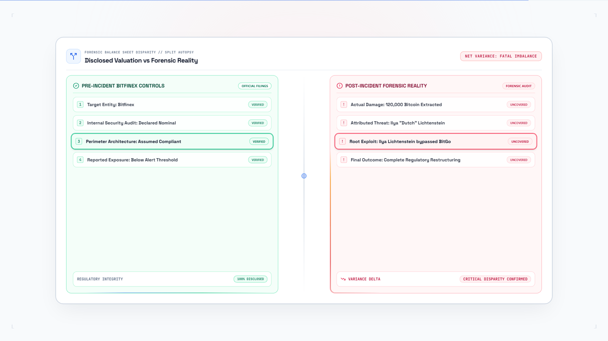
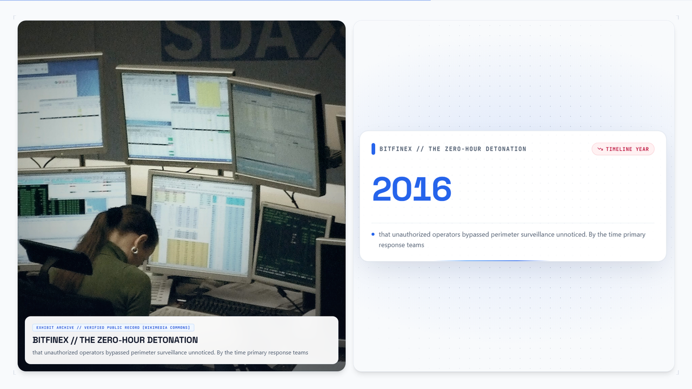
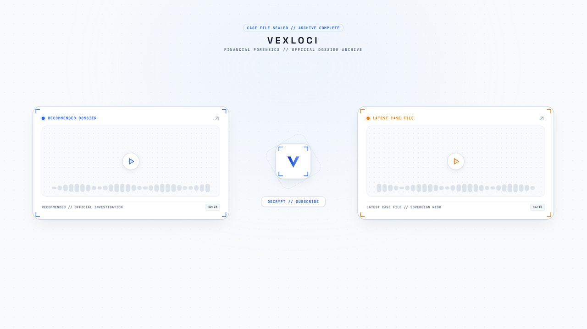
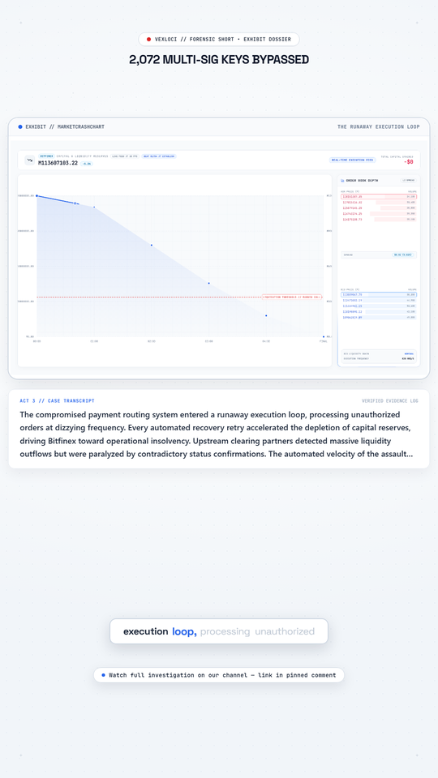
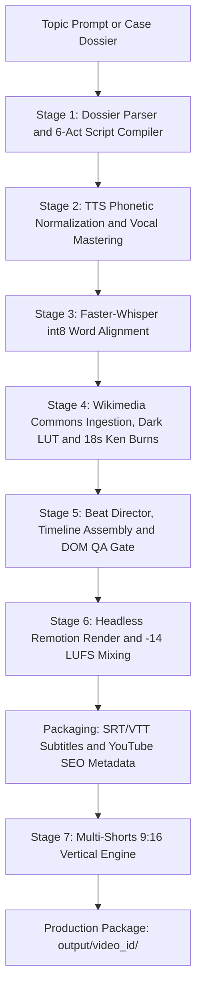

# Vexloci Forensic Video Engine

[](LICENSE)
[](#installation-and-prerequisites)
[](https://remotion.dev)
[](#verification-and-testing)
[](#autonomous-ai-agent-orchestration)

Vexloci compiles full-length 1080p30 forensic documentaries and 9:16 vertical shorts from a single topic prompt or Markdown dossier. The engine orchestrates investigative research, a 6-act script compiler, neural voiceover synthesis, Faster-Whisper word alignment, deduplicated Wikimedia Commons media ingestion, dynamic beat-level cutaways, headless Remotion rendering, sidechain audio mastering, and YouTube distribution packaging.

It runs headlessly from the CLI with deterministic JSON stage artifacts, making it straightforward to drive from AI coding agents such as Claude Code (`claude`), Google Antigravity (`agy`), Cursor, OpenCode, or OpenAI Codex.

---

## Visual showcase


*10-second sequence from the 2026 light editorial engine: `ForensicDocument` transitioning into `MidSceneCutaway` stat and split cards, Bento `SystemBlueprint` fault propagation, `MarketCrashChart` liquidation plunges, and quadrant-routed `GeoIpTraceMap` traces.*

### Scene templates, Beat Director cutaways, and 9:16 Shorts

| ForensicDocument (Light Editorial) | SystemBlueprint (Aceternity Bento) |
| :---: | :---: |
|  |  |
| *Unsealed evidence dockets, chisel highlights, and Reuters/DOJ article clippings* | *Bento topology nodes with border anchor ports and auto-wrapped SVG connector badges* |

| TerminalReplay | MarketCrashChart |
| :---: | :---: |
|  |  |
| *Syntax-highlighted intrusion logs paired with live execution telemetry* | *SVG price plunges, margin call thresholds, and live L2 order book depth* |

| GeoIpTraceMap (Quadrant Routed) | NetworkTopology |
| :---: | :---: |
|  |  |
| *Natural Earth vector projection with hemisphere-locked HUD slots and radar sweep* | *Directed entity graphs with fault-pulse rings and packet throughput readouts* |

| CommsIntercept | SplitAutopsy |
| :---: | :---: |
|  |  |
| *Reconstructed incident messages with inline audio decryption waveforms* | *Disclosed filings contrasted against audited forensic reality* |

| Beat Director Split Cutaway (`MidSceneCutaway`) | Unified Branded Outro (`EndScreenOutro`) |
| :---: | :---: |
|  |  |
| *50/50 archival Wikimedia B-roll paired with animated `NumberTicker` stat cards* | *Clean Vexloci 20-second end-screen layout for YouTube card overlays* |

<div align="center">
  
  <br />
  <em>9:16 <code>ShortForensicComposition</code> with scaled exhibit card, case transcript box, kinetic captions, and bottom CTA pill.</em>
</div>

---

## Recent engine upgrades

1. **2026 Clean Light Editorial UI overhaul.** Replaced the legacy dark neon theme with a light editorial canvas (`#F8FAFC` / `#FFFFFF`), `#0F172A` slate typography, surgical cobalt (`#2563EB`), amber (`#D97706`), and crimson (`#DC2626`) accents across all 12 Remotion templates.
2. **Dynamic Scene Beat Director (`pipeline/beat_director.py`, `pipeline/beat_alignment.py`, `src/components/director/`).** Uses dynamic programming (`_dp_partition_boundaries`) on sentences and Whisper word timings to segment each scene into `0.4s` to `8.5s` visual beats without splitting words or numeric phrases. Automatically injects `CUTAWAY_BROLL`, `CUTAWAY_STATCARD`, and `CUTAWAY_SPLIT` cutaways with `CUT`, `DISSOLVE`, `WHIP_PAN`, and `SCANLINE_GLITCH` transitions.
3. **Zero corner debug HUDs and clean 16:9 broadcast frames.** Removed corner timers, act banners, and beat indicator bars from `KineticHUDOverlay` and `ForensicHUD`, leaving only subtle outer registration brackets and a `2px` top progress line. Long-form 16:9 renders (`MainForensicComposition`) keep the frame free of burned-in subtitles so YouTube uses native `.srt` and `.vtt` closed captions, while 9:16 shorts (`ShortForensicComposition`) retain kinetic lower-third captions.
4. **Camera safety and zero-crop invariant (`CameraRig.tsx`).** Constrained camera zoom on data and diagram templates to `1.0` to `1.02` so headers, Y-axis labels, and peripheral nodes never clip off screen.
5. **Universal script compiler and dossier parser (`pipeline/universal_script_compiler.py`, `pipeline/dossier_parser.py`).** Ingests Markdown or PDF dossiers or runs autonomous topic research to emit 24 topic-isolated scenes across 6 acts (~1,300 to 1,500 spoken words, 8 to 12 minutes) with zero cross-case stub leaks.
6. **Unique Wikimedia Commons media ingestion (`pipeline/stage4_assets.py`).** Queries `commons.wikimedia.org` bitmap files (`filetype:bitmap`, filtering out `.svg` logos and non-photo hits) with strict URL and SHA-256 deduplication, `>= 800px` resolution filtering, luminance preservation, 18s Ken Burns B-roll synthesis, and TrueType investigative article clipping generation.
7. **Humanized TTS phonetics and Whisper glossary alignment (`pipeline/stage2_audio.py`, `pipeline/stage3_align.py`).** Expands hex offsets, currency sums, dates, and double-zero patterns, keeps pronounceable acronyms (`SWIFT`, `NASDAQ`, `FINCEN`, `INTERPOL`) as natural words while spacing initialisms (`RCBC`, `OFAC`), and runs post-alignment glossary cleanup.
8. **Shorts beat normalization and topic-guarded metadata (`pipeline/stage7_shorts.py`, `pipeline/youtube_metadata.py`).** Clips scene-relative word timings and `visualBeats` cleanly within `31s` to `58s` shorts, prevents cross-topic entity bleed, and generates dedicated 9:16 thumbnail prompts per short.

---

## Autonomous AI agent orchestration

Every pipeline stage writes validated JSON and media artifacts under `runs/<video_id>/` and returns deterministic exit codes, allowing coding agents to plan, run, and inspect documentary builds without interactive prompts.


### Agent prompt recipe

Give a prompt like this directly to Claude Code, Antigravity, Cursor, or Codex:

```text
Compile a Vexloci documentary package for:
Topic: "The 2010 Flash Crash: 36 Minutes of Algorithmic Spoofing Chaos"
Video ID: "flash_crash_2010"

1. Run: uv run python run_engine.py --topic "The 2010 Flash Crash" --video-id "flash_crash_2010"
2. Verify that output/flash_crash_2010/ contains long_form/video.mp4, subtitles (.srt and .vtt), youtube_metadata.txt, and 3 shorts.
3. Report the compiled runtime, scene count, and output file sizes.
```

---

## Seven-stage production pipeline



### Stage 1: Research and universal script compiler (`pipeline/stage1_research.py`)
Parses local Markdown/PDF case dossiers via `dossier_parser.py` or compiles autonomous research into a 24-scene, 6-act arc via `universal_script_compiler.py`. `NarrativeContractValidator` verifies hook placement, causal transitions, active open loops, and stakes escalation across roughly 1,300 to 1,500 spoken words.

### Stage 2: Neural vocal synthesis and mastering (`pipeline/stage2_audio.py`)
Synthesizes voice stems using Microsoft Edge-TTS (`en-US-ChristopherNeural`, `rate: +3%`, `pitch: -1Hz`) or Kokoro ONNX (`kokoro-v0_19.onnx` with `am_adam` 70% / `bm_george` 30% blend). `normalize_narration_for_tts` expands hexadecimal addresses, currencies, dates, and double-zero numbers before FFmpeg applies a high-pass filter, parametric EQ, compression, and stereo widening.

### Stage 3: Forced word alignment (`pipeline/stage3_align.py`)
Runs Faster-Whisper (`small.en`, `int8` on CPU) with `word_timestamps=True` and domain `initial_prompt` seeding, then applies `post_process_word_glossary` to fix proper nouns and acronyms in `03_words.json`.

### Stage 4: Archival media and 2.5D assets (`pipeline/stage4_assets.py`)
Harvests deduplicated bitmap photographs from Wikimedia Commons (`>= 800px` wide, SHA-256 hash-checked, filtered against logos and fictional media), applies OpenCV dark LUT grading with luminance floor checks, generates 18-second Ken Burns clips (`_KEN_BURNS_MOTIONS`), segments 2.5D subject cutouts with `rembg`, and renders TrueType article clippings.

### Stage 5: Beat Director, timeline assembly, and DOM QA (`pipeline/stage5_compile.py`)
`compile_scene_visual_beats` groups words into `0.4s` to `8.5s` visual beats (`TEMPLATE_STATE`, `CUTAWAY_BROLL`, `CUTAWAY_STATCARD`, `CUTAWAY_SPLIT`), attaches topic-isolated props across the 12 Remotion templates, appends the 20-second `EndScreenOutro` at Act 6, and runs `verify_dom_qa_playwright` before writing `05_timeline.json`.

### Stage 6: Headless Remotion render and audio mixing (`pipeline/stage6_render.py`)
Renders `MainForensicComposition` via Remotion CLI (`--gl=angle`, `--concurrency=4`), pads narration to full timeline duration (`apad`), applies sidechain ducking (`threshold=0.12`, `ratio=3.2`, `attack=30`, `release=450`) against `assets/music/bg_music_loop.wav`, and normalizes output to `-14 LUFS` / `-1.5 dBFS` true peak.

### Stage 7: Multi-shorts vertical engine (`pipeline/stage7_shorts.py`)
Builds 3 vertical `1080x1920` shorts bounded between `31s` and `58s` via `build_short_packages` and `normalize_short_scenes`, renders `ShortForensicComposition` with `scale(0.535)` exhibit framing, burned-in `KineticCaption` pills, case transcript logs, bottom CTA bars, sliced `.srt`/`.vtt` files, and per-short 9:16 thumbnail prompts.

---

## Remotion scene templates

| Template Name | Component Path | Role in the documentary |
| :--- | :--- | :--- |
| `ForensicDocument` | [ForensicDocument.tsx](src/components/templates/ForensicDocument.tsx) | Unsealed judicial exhibits, animated highlighter sweeps, case stamps, and TrueType news clippings. |
| `TerminalReplay` | [TerminalReplay.tsx](src/components/templates/TerminalReplay.tsx) | Line-by-line intrusion shell logs alongside throughput counters and saturation bars. |
| `MarketCrashChart` | [MarketCrashChart.tsx](src/components/templates/MarketCrashChart.tsx) | Animated SVG valuation plunge curves, liquidation thresholds, and L2 order book depth. |
| `GeoIpTraceMap` | [GeoIpTraceMap.tsx](src/components/templates/GeoIpTraceMap.tsx) | Natural Earth vector map with quadrant-routed HUD cards, curved hop arcs, and radar sweep. |
| `SplitAutopsy` | [SplitAutopsy.tsx](src/components/templates/SplitAutopsy.tsx) | Side-by-side comparison of pre-incident disclosures against audited losses. |
| `SystemBlueprint` | [SystemBlueprint.tsx](src/components/templates/SystemBlueprint.tsx) | Bento architecture nodes with border anchor ports and auto-wrapped SVG connector pills. |
| `NetworkTopology` | [NetworkTopology.tsx](src/components/templates/NetworkTopology.tsx) | Directed entity graphs with fault-pulse rings and lateral intrusion logs. |
| `CommsIntercept` | [CommsIntercept.tsx](src/components/templates/CommsIntercept.tsx) | Reconstructed chat and dispatch transcripts with inline decryption waveforms. |
| `ChronoTickingClock` | [ChronoTickingClock.tsx](src/components/templates/ChronoTickingClock.tsx) | Millisecond UTC incident clock synchronized to milestone reveal cards. |
| `ArchivalFootage` | [ArchivalFootage.tsx](src/components/templates/ArchivalFootage.tsx) | Rotating Wikimedia Commons Ken Burns clips with provenance badges. |
| `ParallaxCutout25D` | [ParallaxCutout25D.tsx](src/components/templates/ParallaxCutout25D.tsx) | Foreground/background segmented 2.5D subject plates with depth drift. |
| `EndScreenOutro` | [EndScreenOutro.tsx](src/components/templates/EndScreenOutro.tsx) | Branded 20-second Vexloci outro frame with dual YouTube end-screen card placeholders. |

---

## Output package layout

Every run writes a self-contained output bundle to `output/<video_id>/`:

```text
output/<video_id>/
├── long_form/
│   ├── video.mp4                 # 1080p30 16:9 clean documentary (no burned-in subtitles)
│   ├── audio.wav                 # Mastered narration track
│   ├── subtitles.srt             # SubRip closed captions
│   ├── subtitles.vtt             # WebVTT closed captions
│   ├── youtube_metadata.json     # Structured SEO metadata and thumbnail prompts
│   └── youtube_metadata.txt      # Ready-to-paste YouTube titles, chapters, tags, and prompts
├── shorts/
│   ├── short_01/                 # 31s-58s vertical 9:16 package (short.mp4, audio_slice.wav, .srt/.vtt, metadata.txt)
│   ├── short_02/
│   └── short_03/
├── assets/                       # Graded archival photos, 18s Ken Burns B-roll clips, and 2.5D cutouts
└── timeline/                     # 01_script.json, 02_scene_timings.json, 03_words.json, 05_timeline.json
```

---

## Installation and prerequisites

### Prerequisites
- Windows 10/11, macOS, or Linux
- Python 3.10+ (managed with `uv`)
- Node.js 18+ and npm
- FFmpeg and `ffprobe` available on system `PATH`

### Setup

```bash
git clone https://github.com/Minhaj009/vexloci.git
cd vexloci

uv sync
npm install

uv run python -c "import cv2, rembg, faster_whisper; print('Python toolchain OK')"
npx tsc --noEmit
```

---

## CLI usage

Run the full 7-stage compiler (long-form 16:9 + 3 vertical 9:16 shorts):

```bash
# Linux/macOS: export PYTHONPATH="."
# PowerShell:  $env:PYTHONPATH="."
uv run python run_engine.py --topic "The 2016 Bitfinex 120,000 Bitcoin Hack" --video-id "bitfinex_bitcoin_hack"
```

Skip rendering vertical shorts (`--no-shorts`):

```bash
uv run python run_engine.py --topic "The 2012 Knight Capital $440M Trading Glitch" --no-shorts
```

Resume from cached artifacts in `runs/<video_id>/` (`--skip-existing`):

```bash
uv run python run_engine.py --topic "The 2016 Bitfinex 120,000 Bitcoin Hack" --video-id "bitfinex_bitcoin_hack" --skip-existing
```

### CLI arguments

| Flag | Type | Description | Default |
| :--- | :--- | :--- | :--- |
| `--topic` | `str` (required) | Topic headline to research and compile | None |
| `--mode` | `str` | Pipeline execution mode (`broadcast_long_form_8_12m`) | `broadcast_long_form_8_12m` |
| `--video-id` | `str` | Custom directory slug under `output/<video_id>/` | Auto-slugified from topic |
| `--no-shorts` | `flag` | Skip rendering 9:16 vertical shorts | `False` |
| `--skip-existing` | `flag` | Reuse completed stage artifacts in `runs/<video_id>/` | `False` |
| `--api-key` | `str` | Optional LLM API key for dynamic research crawl | `None` |

---

## Custom investigative case files

You can feed structured forensic notes into Stage 1 via Markdown or PDF dossiers. See [`examples/demo_story/research.md`](examples/demo_story/research.md) for a complete reference case file covering the 2012 Knight Capital SMARS incident.

---

## Verification and testing

Run the Python test suite and TypeScript typechecker:

```bash
# PowerShell: $env:PYTHONPATH="."
uv run python -m unittest discover -s tests -p "test_*.py" -v
npx tsc --noEmit
```

---

## Hardware budgets

- **VRAM ceiling:** Capped at `6.0 GB` in `pipeline/config.py` (`HARDWARE_SAFETY`), flushing PyTorch/CUDA caches via `flush_cuda_memory()` after heavy stages.
- **CPU execution:** Faster-Whisper runs `small.en` in `int8` on CPU; audio mastering and OpenCV LUT grading run on CPU.
- **Remotion rendering:** Uses headless Chromium with `--gl=angle` and `--concurrency=4`.

---

## Repository layout

```text
vexloci/
├── .gitignore                        # Ignores ephemeral runs, outputs, models, videos, and local dossiers
├── ARCHITECTURE.md                   # System invariants and domain boundaries
├── LESSONS.md                        # Distilled engineering constraints and regressions
├── LICENSE                           # MIT License
├── README.md                         # Engine documentation and visual showcase
├── SPEC.md                           # Behavioral specification
├── package.json                      # Node and Remotion dependencies
├── pyproject.toml                    # Python dependencies and project metadata
├── remotion.config.ts                # Remotion CLI render configuration
├── run_engine.py                     # 7-stage master CLI orchestrator
├── tailwind.config.js                # Light editorial theme tokens
├── tsconfig.json                     # TypeScript compiler configuration
├── docs/                             # Specs and README preview graphics
│   ├── assets/                       # 10s demo GIF and template PNG previews
│   ├── STORYTELLING_FRAMEWORK.md     # 6-act dramatic pacing contract
│   └── VISUAL_PRODUCTION_SPEC.md     # Motion grammar and safe-zone specification
├── examples/demo_story/              # Reference investigative dossier
├── pipeline/                         # Python stage-gate modules
│   ├── audio_synth.py                # Procedural SFX and ambient synth fallback
│   ├── beat_alignment.py             # Sentence segmentation and word-pause grouping
│   ├── beat_director.py              # DP beat clustering and cutaway planner
│   ├── config.py                     # Paths, mastering params, and VRAM budget
│   ├── dossier_parser.py             # Markdown/PDF forensic dossier extractor
│   ├── stage1_research.py            # Stage 1 research and script compiler wrapper
│   ├── stage2_audio.py               # Phonetic normalization, TTS, and EQ mastering
│   ├── stage3_align.py               # Faster-Whisper forced word alignment and glossary
│   ├── stage4_assets.py              # Deduplicated Wikimedia Commons ingestion and LUTs
│   ├── stage5_compile.py             # Timeline assembly, Beat Director integration, DOM QA
│   ├── stage6_render.py              # Remotion render and -14 LUFS sidechain audio mux
│   ├── stage7_shorts.py              # 9:16 multi-shorts slicer, normalizer, and renderer
│   ├── storytelling_engine.py        # Narrative pacing and contract validator
│   ├── subtitles.py                  # Timecoded .srt and .vtt subtitle generator
│   ├── universal_script_compiler.py  # 24-scene topic-isolated script and prop compiler
│   ├── utils_vram.py                 # Garbage collection and CUDA cache flush helpers
│   └── youtube_metadata.py           # Topic-guarded SEO titles, chapters, tags, and prompts
├── src/                              # Remotion React templates and director runtime
│   ├── MainComposition.tsx           # 16:9 clean long-form master composition
│   ├── Root.tsx                      # Remotion composition registry and font loader
│   ├── ShortComposition.tsx          # 9:16 vertical short composition with kinetic captions
│   ├── components/director/          # SceneDirector, MidSceneCutaway, KineticHUDOverlay, context
│   ├── components/shared/            # CameraRig, AtmosphericStage, ForensicHUD, KineticCaption
│   ├── components/templates/         # 12 forensic visual templates
│   ├── components/ui/                # Bento cards, BorderBeam, NumberTicker, RadarSweep, badges
│   ├── lib/                          # Media path resolution and class helpers
│   ├── schemas/timeline.schema.ts    # Zod contracts shared with Python timeline compiler
│   └── styles/global.css             # Tailwind base styles
└── tests/                            # Automated Python regression suite
```

---

## License and fair use

The Vexloci engine code is licensed under the [MIT License](LICENSE). Archival media fetched from Wikimedia Commons remains subject to each file's Creative Commons or Public Domain license.
