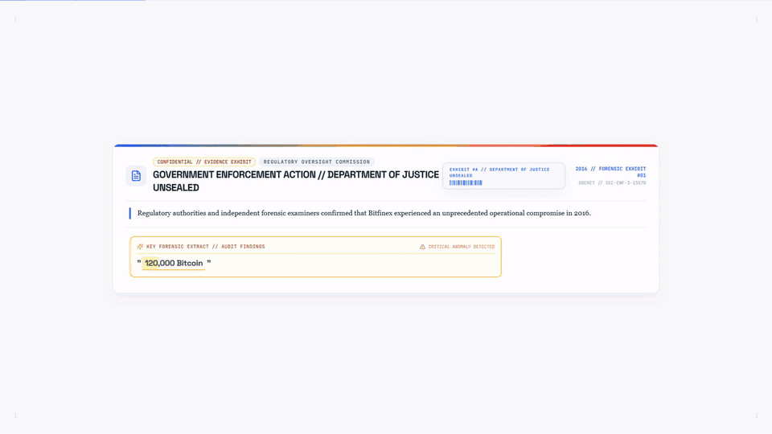
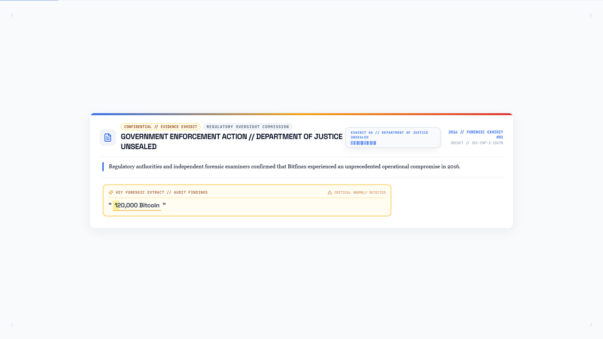
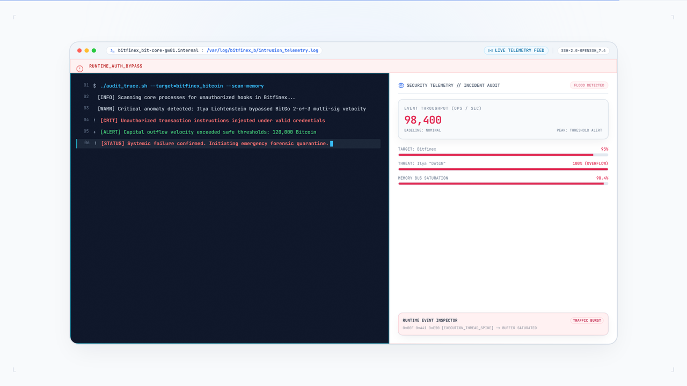
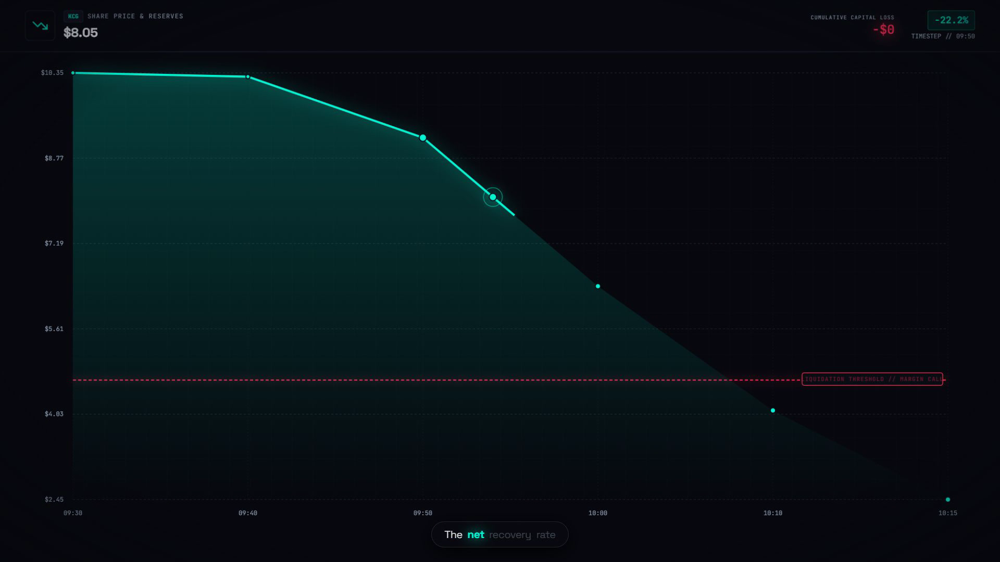
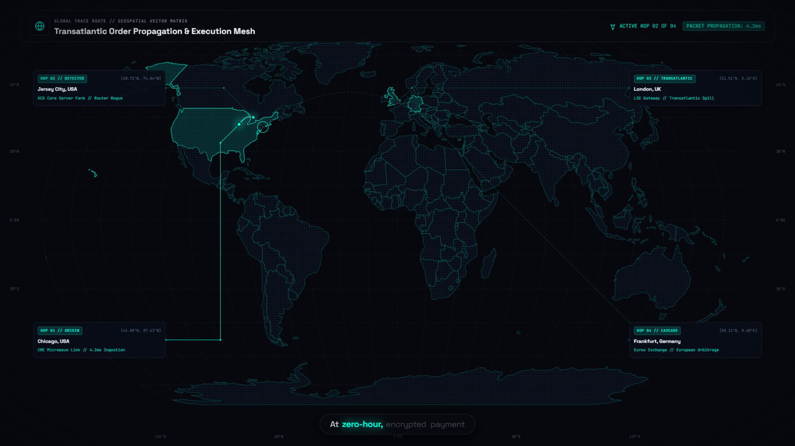
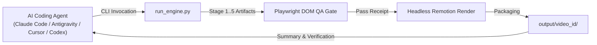
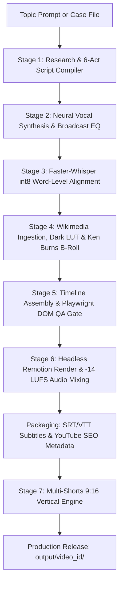

# Vexloci // Forensic Video Engine

[](LICENSE)
[](#installation--prerequisites)
[](https://remotion.dev)
[](#verification--testing)
[](#autonomous-ai-agent-orchestration)

> **Autonomous AI-Driven Investigative Documentary & Multi-Shorts Production Compiler**

Vexloci is an end-to-end autonomous video production engine engineered to compile broadcast-quality forensic documentaries on technological disasters, cyber heists, financial collapses, and institutional crimes. Given a single topic prompt, the engine orchestrates investigative research, multi-act scripting, neural voice synthesis, Whisper word alignment, public domain archival asset harvesting, 2.5D Ken Burns animation, 1080p60/1080p30 Remotion canvas rendering, sidechain audio ducking, and complete YouTube distribution packaging.

Built with an **agent-first architecture**, Vexloci is designed to be executed out-of-the-box by any AI coding agent provider—including **Claude Code (`claude`)**, **Google Antigravity (`agy`)**, **Cursor**, **OpenCode**, **OpenAI Codex**, **Windsurf**, or custom LLM orchestration loops.

---

## Visual Showcase // Engine Output Demo



> *10-second multi-scene sequence compiled by Vexloci showing automated forensic document highlighting, terminal opcode replay, candlestick market crash charts, and transnational GeoIP trace mapping. Full 1080p sample available at [`docs/assets/vexloci_demo_10s.mp4`](docs/assets/vexloci_demo_10s.mp4).*

### Flagship Forensic Templates

| Forensic Evidence Docket | Terminal Replay & Opcode Exec |
| :---: | :---: |
|  |  |
| *Unsealed evidence exhibits with kinetic chisel highlighters & case stamps* | *Syntax-highlighted terminal sessions & execution telemetry* |

| Candlestick Market Crash | Transnational GeoIP Routing |
| :---: | :---: |
|  |  |
| *SVG financial candlestick plunges & real-time liquidity ledgers* | *Vector geospatial route vectors & hop coordinates* |

---

## Key Highlights

- **Autonomous Agent-Native Runtime:** Non-interactive CLI with deterministic exit codes, JSON state files, and zero-prompt execution designed for Claude Code, Antigravity, Cursor, and Codex workers.
- **Hardcoded 8–12 Minute Long-Form Documentaries:** Generates a universal 24-scene forensic arc across 6 acts (~1,250–1,450 words) delivering 9.5 to 11.2 minutes of broadcast runtime.
- **Hardcoded 30–60 Second Vertical Shorts (9:16):** Automatically produces 3 vertical 1080x1920 shorts per documentary with mobile-safe kinetic captions and bottom call-to-action banners.
- **Enterprise Broadcast Audio Mastering:** Edge-TTS / Kokoro neural voiceover mastered with 6-band parametric EQ, multiband compression, and `-14 LUFS` sidechain ducking over an atmospheric dark synth score.
- **Full YouTube SEO & Metadata Distribution:** Compiles 3 high-CTR title variations, chapter timestamps, 30+ SEO tags, hashtags, pinned comments, and photorealistic **Nano Bana 2 Pro** thumbnail prompts for both 16:9 and 9:16 aspect ratios.
- **Whisper Subtitles (.srt & .vtt):** Timecoded closed captions grouped into natural 4–7 word phrases for both the long-form video and every individual short.
- **Automated Playwright DOM QA Gate:** Headless browser pre-flight audit that asserts zero visual element collisions between HUD meters, cards, and captions prior to Remotion rendering.
- **Zero Decorative Jargon:** Clean, dark forensic visual aesthetic inspired by technical terminal feeds, unsealed judicial evidence dockets, and financial autopsy ledgers.

---

## Autonomous AI Agent Orchestration

Vexloci was engineered from day one as an **agentic software system**. Because every stage of the pipeline produces deterministic JSON manifests, handles fallbacks gracefully, and exposes a clean CLI interface, autonomous AI coding agents can plan, research, compile, and QA full documentary packages without human intervention.



### Supported AI Agent Providers
- **Claude Code (`claude`):** Run `claude` in the workspace directory. Instruct Claude to investigate a historical disaster or supply case files to compile complete documentary packages.
- **Google Antigravity (`agy`):** Execute agentic pair-programming workflows, orchestrate multi-subagent pipelines, and inspect rendered output frames.
- **Cursor / Windsurf:** Use Composer or chat agents to script custom scene templates, adjust design tokens in `pipeline/config.py`, or trigger parallel rendering batches.
- **OpenCode & OpenAI Codex:** Invoke background worker runs with non-interactive CLI flags across CI/CD or local dev environments.
- **Custom Autonomous Loops:** Script overnight content compilers using simple shell scripts or Python runners.

### Agent Prompt Recipes

#### Recipe 1: End-to-End Autonomous Generation (Zero-Shot Topic)
Give this prompt directly to your AI agent (Claude Code, Antigravity, Cursor):

```text
Run the Vexloci video compiler for the following incident:
Topic: "The 2010 Flash Crash — 36 Minutes of Algorithmic Spoofing Chaos"
Video ID: "flash_crash_2010"

Instructions:
1. Verify the Python and Node environment.
2. Execute: uv run python run_engine.py --topic "The 2010 Flash Crash" --video-id "flash_crash_2010"
3. Inspect output/flash_crash_2010/ and verify long_form/video.mp4, all 3 shorts, subtitles (.srt/.vtt), and youtube_metadata.txt exist.
4. Report the final duration, file sizes, and verification receipt.
```

#### Recipe 2: Compiling from a Custom Investigative Research Docket
When you want the agent to use proprietary research or detailed forensic notes:

```text
I have placed an investigative case file in examples/demo_story/research.md detailing the 2012 Knight Capital SMARS glitch.
1. Review the timeline, code defects, and telemetry in the case file.
2. Compile a broadcast documentary using:
   uv run python run_engine.py --topic "Knight Capital $440M Algorithmic Glitch" --video-id "knight_capital_glitch"
3. Run the Playwright DOM QA gate to prove zero layout collisions.
4. Deliver the distribution metadata package.
```

---

## 7-Stage Production Pipeline



### Stage 1: Research & Universal Script Compiler (`pipeline/stage1_research.py`)
Deconstructs any forensic, technological, or financial topic into a rigid 6-act dramatic arc:
- **Act 1: The Cold Open & Anomaly Discovery** (Scenes 1–4) — High-tension opening metric, anomaly detection, initial indicator.
- **Act 2: The Architectural Flaw & Infiltration** (Scenes 5–8) — Code defect, missing guardrail, unauthorized lateral access.
- **Act 3: The Zero-Hour Execution & Cascade** (Scenes 9–12) — Trigger event, recursive execution loop, automated escalation.
- **Act 4: Global Contagion & Intercepted Signals** (Scenes 13–16) — Multi-exchange contagion, emergency communications, sensor telemetry.
- **Act 5: Financial Plunge & Liquidity Collapse** (Scenes 17–20) — Capital destruction, balance sheet impairment, emergency meetings.
- **Act 6: Forensic Autopsy & Institutional Legacy** (Scenes 21–24) — Regulatory fines, permanent rule changes, criminal indictments.

*Hardcoded Delivery Formula:* Exactly 24 scenes (~55–65 words per scene; ~1,250–1,450 words total) delivering 9.5 to 11.2 minutes of continuous narration at 130–140 words per minute.

### Stage 2: Neural Vocal Synthesis & Broadcast EQ (`pipeline/stage2_audio.py`)
- Synthesizes vocal stems using Microsoft Edge-TTS (`en-US-ChristopherNeural`, calibrated to `rate: +3%`, `pitch: -1Hz`) or local Kokoro ONNX (`am_adam` 70% / `bm_george` 30% neural blend).
- Normalizes hexadecimal offsets (`0x8888`), financial sums (`$440M` -> "four hundred forty million dollars"), acronyms, and military timestamps.
- Applies a 6-band parametric mastering vocal chain:
  - 80Hz 18dB/octave high-pass filter (sub-rumble removal)
  - 160Hz +1.5dB wide-bell boost (vocal chest resonance)
  - 450Hz -2.0dB surgical notch (nasal mud removal)
  - 2.8kHz +2.5dB articulation shelf (consonant clarity)
  - 3:1 multiband compression with 30ms attack and 200ms release
  - Micro-delay stereo widener (0.8ms Haas effect for spatial separation)

### Stage 3: Forced Word Alignment (`pipeline/stage3_align.py`)
- Executes Faster-Whisper (`tiny.en` int8 quantized on CPU) to extract millisecond-accurate start and end boundaries for every word.
- Produces `03_words.json` containing phonetic timestamps used to synchronize on-screen kinetic captions and timecoded `.srt`/`.vtt` subtitles.

### Stage 4: Asset Ingestion, Dark LUT & Ken Burns B-Roll (`pipeline/stage4_assets.py`)
- Queries Wikimedia Commons and MediaWiki REST APIs for public-domain historical photography, corporate headquarters, executive mugshots, and archival documents.
- Applies OpenCV dark forensic 3D LUT grading (warm desaturation, obsidian contrast curve, cyan/teal shadow cast).
- Generates 35-second slow-zoom Ken Burns motion sequences (`zoompan`) via FFmpeg.
- Runs 2.5D background/foreground layer segmentation using `rembg` (`u2netp`) to separate subject cutouts from contextual backgrounds.

### Stage 5: Timeline Assembly & DOM QA Gate (`pipeline/stage5_compile.py`)
- Maps narration beats to 12 specialized Remotion templates based on narrative keyword semantics.
- Launches a headless Playwright Chromium instance that loads every scene into a virtual DOM canvas, asserting:
  - Zero overlapping bounding boxes between kinetic highlighters, HUD meters, and caption pills.
  - Safe-zone boundary compliance ($X \ge 96\text{px}$, $Y \ge 72\text{px}$).
  - Dynamic font scale clamping preventing text truncation.

### Stage 6: Headless Remotion Render & Audio Mixing (`pipeline/stage6_render.py`)
- Executes Remotion CLI headless rendering (`MainForensicComposition`, `--gl=angle`, `--concurrency=4`).
- Procedurally synthesizes or loops an atmospheric dark ambient synth score (`assets/music/bg_music_loop.wav`).
- Sidechain ducking: Compresses background music by 3.2:1 with a 30ms attack and 450ms release whenever narration voiceover is present.
- Masters the output audio stream strictly to `-14.0 LUFS` (EBU R128 broadcast standard) with a `-1.5 dBFS` true-peak ceiling.

### Stage 7: Multi-Shorts Production Engine (`pipeline/stage7_shorts.py`)
- Extracts 3 self-contained narrative packages strictly bounded between **30 and 60 seconds** (32s–58s):
  - **Short 1: The Cold Open Hook** (Scenes 1–3)
  - **Short 2: The Critical Flaw / Breach** (Scenes 6–8)
  - **Short 3: The Liquidity Collapse / Autopsy** (Scenes 20–22)
- Renders vertical 1080x1920 compositions via `ShortForensicComposition` in Remotion.
- Centers visual cards with `scale(0.56)` and displays kinetic captions in the mobile-safe lower-third ($Y=1320\text{px}$).
- Embeds a bottom call-to-action banner (`FULL INVESTIGATION AVAILABLE // Link In Pinned Comment & Description // WATCH FULL ▶`).
- Slices synchronized audio stems, generates standalone vertical `.srt`/`.vtt` subtitles, and formats dedicated short metadata.

---

## 12 Cinematic Remotion Scene Templates

Every scene compiled by Vexloci is visually hosted by one of 12 purpose-built React/Remotion templates styled in an authentic dark forensic aesthetic:

| Template Name | Component Path | Purpose & Visual Design |
| :--- | :--- | :--- |
| **`ForensicDocument`** | [`src/components/templates/ForensicDocument.tsx`](src/components/templates/ForensicDocument.tsx) | Unsealed judicial evidence dockets, investigative newsprint, fluorescent chisel highlighters, and red case stamps. |
| **`TerminalReplay`** | [`src/components/templates/TerminalReplay.tsx`](src/components/templates/TerminalReplay.tsx) | Syntax-highlighted CLI terminal logs, opcode hex memory dumps, and real-time command execution feeds. |
| **`MarketCrashChart`** | [`src/components/templates/MarketCrashChart.tsx`](src/components/templates/MarketCrashChart.tsx) | SVG candlestick charts with cascading loss plunges, volume indicators, and delta exposure pills. |
| **`GeoIpTraceMap`** | [`src/components/templates/GeoIpTraceMap.tsx`](src/components/templates/GeoIpTraceMap.tsx) | Transnational vector map with animated hop vectors, millisecond latency metrics, and IP coordinates. |
| **`SplitAutopsy`** | [`src/components/templates/SplitAutopsy.tsx`](src/components/templates/SplitAutopsy.tsx) | Comparative balance-sheet ledgers contrasting "Disclosed State" vs "Forensic Reality" with red delta variance pills. |
| **`SystemBlueprint`** | [`src/components/templates/SystemBlueprint.tsx`](src/components/templates/SystemBlueprint.tsx) | Technical architectural schematics, unmanaged switch wireframes, and data flow topologies. |
| **`NetworkTopology`** | [`src/components/templates/NetworkTopology.tsx`](src/components/templates/NetworkTopology.tsx) | Directed node graphs illustrating lateral cyber intrusion and decentralized validator architectures. |
| **`CommsIntercept`** | [`src/components/templates/CommsIntercept.tsx`](src/components/templates/CommsIntercept.tsx) | Reconstructed encrypted chat sessions (Signal, Telegram, IRC, Bloomberg Terminal chat). |
| **`ChronoTickingClock`** | [`src/components/templates/ChronoTickingClock.tsx`](src/components/templates/ChronoTickingClock.tsx) | High-tension countdown timers with millisecond dials, incident countdowns, and acoustic sub-bass sweeps. |
| **`ArchivalFootage`** | [`src/components/templates/ArchivalFootage.tsx`](src/components/templates/ArchivalFootage.tsx) | MediaWiki historical photo plates with slow-pan Ken Burns animation, vignette shading, and provenance badges. |
| **`ParallaxCutout25D`** | [`src/components/templates/ParallaxCutout25D.tsx`](src/components/templates/ParallaxCutout25D.tsx) | Multi-plane 2.5D camera rig panning across foreground subject cutouts over deep blurred backgrounds. |
| **`EndScreenOutro`** | [`src/components/templates/EndScreenOutro.tsx`](src/components/templates/EndScreenOutro.tsx) | Hardcoded YouTube 20-second end-screen card layout with interactive subscriber reticle and case docket seal. |

---

## Output Architecture

Every documentary compiled by Vexloci produces a self-contained, modular release package inside `output/<video_id>/`:

```
output/<video_id>/
├── long_form/
│   ├── video.mp4                 # 1080p30 16:9 Full Forensic Documentary (~9.5-11.2 min)
│   ├── audio.wav                 # Mastered Vocal Track (48kHz PCM WAV)
│   ├── subtitles.srt             # Timecoded SubRip Closed Captions
│   ├── subtitles.vtt             # WebVTT Closed Captions (HTML5 standard)
│   ├── youtube_metadata.json     # Machine-readable distribution metadata
│   └── youtube_metadata.txt      # Ready-to-copy Titles, Description, Chapters, Tags & Thumbnail Prompts
├── shorts/
│   ├── short_01/                 # Act 1 Hook Short (Peak Incident Cut, 30s-60s)
│   │   ├── short.mp4             # 1080x1920 Vertical 9:16 Video (Kinetic Captions + Bottom CTA Bar)
│   │   ├── audio_slice.wav       # Synchronized Audio Stem
│   │   ├── subtitles.srt             # Synchronized Short Subtitles
│   │   ├── subtitles.vtt             # Synchronized WebVTT
│   │   └── metadata.txt          # Title, Description, Hashtags & Pinned Comment
│   ├── short_02/                 # Act 2/3 Technical Flaw & Breach Short (30s-60s)
│   └── short_03/                 # Act 5/6 Liquidity Collapse & Balance Sheet Short (30s-60s)
├── assets/                       # Wikimedia photos, 35s Ken Burns b-rolls & 2.5D subject cutouts
└── timeline/                     # Compiled 6-act scripts, word alignments, and layout manifests
```

---

## Installation & Prerequisites

### Prerequisites
- **Operating System:** Windows 10/11, macOS, or Linux
- **Python:** 3.11+
- **Node.js:** 18+ (with npm)
- **FFmpeg:** Must be installed and accessible on system `PATH`
- **uv:** Recommended modern Python package manager (`pip install uv` or `winget install astral-sh.uv`)

### Setup Instructions

```bash
# 1. Clone repository
git clone https://github.com/Minhaj009/vexloci.git
cd vexloci

# 2. Install Python dependencies via uv
uv sync

# 3. Install Node & Remotion dependencies
npm install

# 4. Verify system toolchain & typecheck
uv run python -c "import torch, cv2, rembg; print('Python toolchain OK')"
npx tsc --noEmit
```

---

## CLI Usage Guide

### 1. Compile from a Topic String
To compile an entire investigative documentary package (long-form + 3 vertical shorts):

```bash
# Set PYTHONPATH and run master orchestrator
export PYTHONPATH="." # On Windows PowerShell: $env:PYTHONPATH="."
uv run python run_engine.py --topic "The 2012 Knight Capital $440M Trading Glitch" --video-id "knight_capital_glitch"
```

### 2. Fast Render (Skip Shorts)
If you only need the 16:9 full-length documentary:

```bash
uv run python run_engine.py --topic "The 2016 Bitfinex 120,000 Bitcoin Hack" --no-shorts
```

### 3. Resume / Accelerated Pipeline (`--skip-existing`)
To iterate on visual styles without re-synthesizing voiceover or re-running Whisper alignment:

```bash
uv run python run_engine.py --topic "The 2012 Knight Capital $440M Trading Glitch" --video-id "knight_capital_glitch" --skip-existing
```

### CLI Arguments Reference
| Flag | Type | Description | Default |
| :--- | :--- | :--- | :--- |
| `--topic` | `str` *(required)* | Topic headline (e.g. `"The 2016 Bangladesh Bank $81M Cyber-Heist"`) | None |
| `--video-id` | `str` | Custom folder name under `output/<video_id>/` | Auto-slugified from topic |
| `--no-shorts` | `flag` | Skip rendering vertical 9:16 shorts | `False` |
| `--skip-existing` | `flag` | Reuse existing stage artifacts in `runs/<video_id>` to accelerate resume | `False` |
| `--api-key` | `str` | Optional Gemini/OpenAI API key for dynamic Wikipedia research crawl | `None` |

---

## Custom Investigative Case Files (`examples/demo_story/`)

In addition to autonomous topic generation, Vexloci supports ingesting structured investigative case files formatted in Markdown. An authentic investigative reference file is provided at [`examples/demo_story/research.md`](examples/demo_story/research.md).

It documents how to structure forensic telemetry for the engine:
1. **Executive Forensic Summary:** Incident window, verified monetary casualties, share volumes, and regulatory penalties.
2. **Chronological Zero-Hour Timeline:** Second-by-second incident progression with timestamps.
3. **Technical Defect & Architecture Autopsy:** Code defect analysis, routing diagrams, and failed rollback analysis.
4. **Market Contagion & Liquidity Casualty:** Broken trades, circuit breakers, and price distortion.
5. **Institutional Legacy & Regulatory Impact:** SEC/FINRA enforcement actions, statutory changes (e.g., Regulation SCI).

---

## Verification & Testing

Verify that your local environment passes all unit tests and TypeScript contracts:

```bash
# 1. Run Python unit test suite
export PYTHONPATH="." # On Windows PowerShell: $env:PYTHONPATH="."
uv run python -m unittest tests/test_endscreen_outro.py tests/test_metadata_and_subtitles.py tests/test_storytelling_framework.py

# 2. Verify Remotion & TypeScript schemas
npx tsc --noEmit
```

---

## Hardware Budgets & Resource Profiling

- **Peak VRAM Safety Budget:** Bounded strictly below **2.5 GB peak VRAM**.
- **CPU Friendly:** Faster-Whisper runs on CPU via `int8` quantization. Vocal mastering and OpenCV LUT grading operate with zero GPU dependency.
- **Remotion Hardware Acceleration:** Remotion renders via ANGLE/Vulkan headless OpenGL (`--gl=angle`) utilizing multi-threaded CPU workers (`--concurrency=4`).
- **Memory Defense:** Python sub-processes invoke garbage collection and CUDA memory cache flushes between stages.

---

## Repository Layout

```
vexloci/
├── .gitignore                   # Multi-runtime ignore manifest (Node, Python, temp runs)
├── ARCHITECTURE.md              # Living architecture & domain boundary specification
├── LESSONS.md                   # Living engineering reinforcement memory
├── LICENSE                      # MIT Open Source License
├── README.md                    # Master developer & AI agent documentation
├── SPEC.md                      # System behavioral specification
├── package.json                 # Node & Remotion dependency definitions
├── pyproject.toml               # Python project configuration & toolchain dependencies
├── remotion.config.ts           # Remotion render configuration & OpenGL flags
├── run_engine.py                # Master CLI orchestrator entrypoint
├── tailwind.config.js           # Tailwind CSS theme tokens & HUD scanline animations
├── tsconfig.json                # TypeScript strict compilation configuration
├── docs/                        # Architectural specifications & visual showcase assets
│   ├── assets/                  # 10s animated GIF demo, MP4 sample, and template preview cards
│   ├── STORYTELLING_FRAMEWORK.md# 6-act dramatic progression invariants
│   └── VISUAL_PRODUCTION_SPEC.md# 1080p motion grammar & safe-zone constraints
├── examples/                    # Sample investigative dossiers & case files
│   └── demo_story/              # Knight Capital $440M trading glitch reference file
├── pipeline/                    # 7-stage Python pipeline modules
│   ├── config.py                # Design tokens, mastering params & hardware budgets
│   ├── stage1_research.py       # Topic research & 6-act universal script compiler
│   ├── stage2_audio.py          # Neural voice synthesis (Edge-TTS / Kokoro) & mastering
│   ├── stage3_align.py          # Faster-Whisper int8 forced word alignment
│   ├── stage4_assets.py         # MediaWiki harvesting, dark LUT & Ken Burns b-roll
│   ├── stage5_compile.py        # Timeline compiler & Playwright DOM QA verification gate
│   ├── stage6_render.py         # Remotion headless render & -14 LUFS sidechain ducking
│   ├── stage7_shorts.py         # Vertical 9:16 multi-shorts production engine
│   ├── storytelling_engine.py   # Narrative arc contracts & pacing rules
│   ├── subtitles.py             # SRT/VTT timecoded closed caption generator
│   └── youtube_metadata.py      # SEO titles, chapters, tags & Nano Bana 2 Pro prompts
├── src/                         # Remotion React component ecosystem
│   ├── MainComposition.tsx     # 16:9 Long-form master composition
│   ├── Root.tsx                 # Remotion root registry & Google Fonts loader
│   ├── ShortComposition.tsx    # 9:16 Vertical shorts composition
│   ├── components/              # 12 Forensic templates & shared camera rigs / HUD overlays
│   ├── schemas/                 # Zod timeline schemas & prop validators
│   └── styles/                  # Tailwind CSS styling & CRT scanline overlays
└── tests/                       # Automated regression & contract verification suite
```

---

## License & Fair Use
The software and engine code are licensed under the [MIT License](LICENSE). Archival assets retrieved dynamically via MediaWiki are subject to their respective Creative Commons or Public Domain licenses. Documentaries compiled by this engine are designed for educational, investigative, and historical analysis purposes under fair use guidelines.
