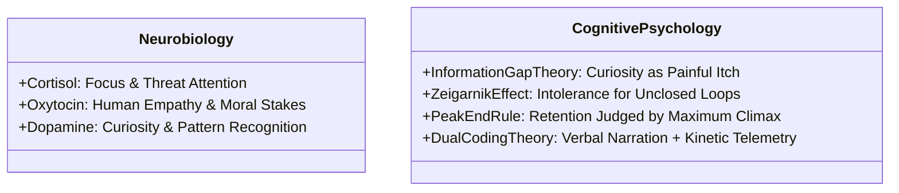

# STORYTELLING FRAMEWORK & RETENTION PSYCHOLOGY
**Universal Narrative Architecture for Long-Form Forensic Documentaries (8–18 Minutes)**  
**Project:** Vexloci Forensic Video Engine  
**Target:** 1080p30 / 4K Broadcast Documentary Series  
**Theoretical Baseline:** Classical Dramaturgy, Cognitive Psychology, Information Theory, Neurochemistry, and YouTube Viewer Retention Science  

---

## 1. Executive Summary: The Law of Continuous Cognitive Tension

A viewer does not abandon a documentary because the subject matter is complicated; they abandon it because the narrative releases **cognitive tension**. 

In high-stakes technical investigations—spanning cyber-heists, algorithmic collapses, sovereign currency thefts, and corporate accounting frauds—retention is governed by a single neuro-cognitive law:
> **The viewer must never be allowed to feel that their current understanding of the event is complete.**

Every scene must function not as an isolated informational report, but as a link in a causal chain of escalating stakes. The Vexloci storytelling framework synthesizes 2,400 years of narrative theory—from Aristotle's *Poetics* to modern high-retention algorithmic pacing—into an executable, hardcoded engine contract.

```mermaid
flowchart TD
    subgraph Classical["Classical & Screenwriting Foundations"]
        A["Aristotle's Poetics<br/>(Hamartia, Peripeteia, Anagnorisis)"] --> B["Freytag's Pyramid<br/>(Rising Dramatic Velocity)"]
        B --> C["McKee & Field<br/>(The Expectation Gap & Turning Points)"]
        C --> D["South Park Invariant<br/>('Therefore / But' vs 'And Then')"]
    end

    subgraph Cognitive["Cognitive & Neurochemical Drivers"]
        E["Loewenstein Information Gap<br/>(Curiosity as Cognitive Itch)"] --> F["Zeigarnik Effect<br/>(Tension of Unresolved Loops)"]
        F --> G["Paul Zak Neurochemistry<br/>(Cortisol Stakes + Dopamine Resolution)"]
        G --> H["Kahneman Peak-End Rule<br/>(Calculated Dramatic Climax)"]
    end

    subgraph Digital["YouTube & Streaming Retention Science"]
        I["30-Second Hook Rule<br/>(Zero-Hour Incident Injection)"] --> J["Nested Open Loops<br/>(Russian Doll Information Queues)"]
        J --> K["Veritasium Curiosity Escalation<br/>(Micro-Anomaly to Macro-Existential Crisis)"]
        K --> L["Johnny Harris / Vox Visual Pacing<br/>(Macro Evidence Beats Every 45-60s)"]
    end

    Classical --> M["The Vexloci 6-Act Forensic Engine"]
    Cognitive --> M
    Digital --> M
```

---

## 2. Chronological Evolution of Narrative Theory

### 2.1 Classical Foundations (4th Century BCE – 19th Century)

#### 1. Aristotle’s *Poetics* (c. 335 BCE)
Aristotle established the primary mechanics of drama that remain the bedrock of narrative retention:
- **Plot (*Mythos*) over Character (*Ethos*):** The action is the engine of drama. A documentary cannot meander through biography; it must track the relentless consequences of actions.
- **Hamartia (The Fatal Flaw / The Systemic Blind Spot):** The catastrophe is not born of random misfortune, but an inherent, tragic vulnerability within the system or protagonist (e.g., Knight Capital leaving obsolete test code active on node 8; Bangladesh Bank routing sovereign SWIFT transfers through cheap unmanaged switches).
- **Peripeteia (The Sudden Reversal):** An action produces the exact opposite of its intended result (e.g., German regulator BaFin banning short-selling Wirecard to protect national pride, which directly enabled the fraud to metastasize into a €20B crater).
- **Anagnorisis (The Critical Discovery / Unmasking):** The moment ignorance shifts into horrifying awareness (e.g., KPMG realizing Philippine bank confirmation letters are forged; Deutsche Bank noticing "foundation" spelled as "fandation").
- **Catharsis (Emotional Resolution):** The purging of cognitive tension through the final, undeniable forensic truth.

#### 2. Gustav Freytag’s Dramatic Pyramid (1863)
Freytag codified the 5-part structure of dramatic velocity:
1. **Introduction (Inciting Incident):** The status quo is punctured.
2. **Rising Action:** Conflicts multiply; stakes escalate exponentially.
3. **Climax (The Turning Point):** Maximum tension; the point of no return.
4. **Falling Action (The Unraveling):** The inevitable consequences cascade through the system.
5. **Catastrophe / Denouement:** The new, permanently altered reality is established.

---

### 2.2 20th Century Screenwriting & Structuralism

#### 1. Robert McKee (*Story*, 1997) & Syd Field (*Screenplay*, 1979)
- **The Gap Between Expectation and Reality:** Narrative energy is created whenever an entity takes an action expecting one result, and reality strikes back with an unexpected, escalating consequence.
- **The Principle of Antagonism:** A story is only as compelling as the forces of antagonism arrayed against its subject. In forensic crime, the antagonist is the combination of adversary ingenuity and systemic institutional negligence.
- **Value Charges (+ / –):** Every single scene must begin with a value in one state (e.g., *Security*, *Solvency*, *Control*) and end in the opposite state (*Breached*, *Insolvent*, *Panic*). A scene that enters and exits with the same value charge is dead weight.

#### 2. Trey Parker & Matt Stone: The "Therefore / But" Invariant
The definitive rule of narrative momentum formulated for *South Park*:
> **If the words "and then" connect your scenes, your story is broken. Every scene must be linked by "THEREFORE" (cause-and-effect) or "BUT" (conflict and reversal).**

- **The Episodic Failure ("And Then"):** *"The hackers entered the bank network, and then they harvested credentials, and then they drafted payment messages, and then the money went to Manila."* (Viewer drops off; feels like a list).
- **The Causal Velocity ("Therefore / But"):** *"The hackers breached an unpatched Motijheel PC. **THEREFORE**, they obtained lateral access to the SWIFT core. **BUT** the SWIFT Alliance software automatically logged and printed every transaction. **THEREFORE**, the attackers engineered a byte-level assembly patch to blind the printer. **BUT** a single spelling typo in an offshore routing transit triggered a manual compliance review."*

#### 3. Dan Harmon’s Story Circle & Blake Snyder’s Beat Sheet
Harmon's 8-step cybernetic loop adapted for investigative autopsy:
1. **Zone of Comfort:** The target institution operating normally.
2. **Need / Glitch:** An anomaly manifests in telemetry.
3. **Go (Crossing the Threshold):** Investigators or adversaries cross the security perimeter.
4. **Search / Adapt:** The forensic hunt through corrupted records.
5. **Find:** Uncovering the smoking gun artifact.
6. **Take:** The catastrophic price paid (capital wiped, servers locked).
7. **Return:** The emergency public disclosure.
8. **Change:** The permanent systemic aftermath and regulatory paradigm shift.

---

### 2.3 Cognitive Science & Neurobiology of Viewer Engagement

#### 1. George Loewenstein's Information Gap Theory (1994)
Curiosity is not a passive intellectual preference; it is a **cognitively painful deprivation state**. When an individual perceives a gap between what they know and what they *need* to know, their brain activates dopamine-seeking behavior that cannot rest until the gap is closed.
- **Application:** State the mystery clearly in the first 15 seconds, but deliberately withhold the critical mechanism until the climax.

#### 2. The Zeigarnik Effect (Bluma Zeigarnik, 1927)
Uncompleted tasks or unresolved questions produce high mental tension that dominates cognitive recall. Once closed, the brain purges the information.
- **Application (Nested Open Loops):** Never close all questions at once. Before resolving Mystery A, open Mystery B. The viewer remains perpetually hooked by at least one active open loop.

#### 3. Paul Zak's Neurochemical Narrative Model
- **Cortisol:** Released by rising threat, high financial jeopardy, and ticking clocks. Sharpens visual focus and raises alertness.
- **Oxytocin:** Released by human stakes, betrayal, whistleblower bravery, and the destruction of ordinary workers' livelihoods.
- **Dopamine:** Released when the viewer discovers a clue, recognizes a forensic pattern, or watches an encrypted log file decrypt in real-time.

#### 4. Daniel Kahneman's Peak-End Rule (1993)
Viewers do not evaluate an experience by calculating the arithmetic average of every second. They judge it almost entirely by two points:
1. **The Peak:** The most emotionally or intellectually intense moment (Act 5: The Catastrophic Cascade).
2. **The End:** The concluding verdict and systemic revelation (Act 6: The Forensic Autopsy).

---

### 2.4 Modern Digital & YouTube Retention Science (2015 – 2026)

#### 1. The 30-Second Hook Rule
The introductory 30 seconds dictate 80% of video retention:
- **Banned:** Generic logos, channel intros, "In this video we will explore...", pleasantries, historical filler before 2000.
- **Mandatory:**
  - **Second 0–5:** The Incident Zero-Hour (The disaster already happening).
  - **Second 6–15:** The Inconceivable Dollar/Human Metric ($951M stolen; $440M lost in 45 minutes).
  - **Second 16–30:** The Central Paradox (How the most secure institution in the world was defeated by a single character or a $10 switch).

#### 2. Veritasium’s Curiosity Escalation Model (Derek Muller)
A story must escalate its questions along a pyramid:
- **Level 1 (The Micro-Puzzle):** *"Why did this printer stop printing paper in Dhaka on a Friday morning?"*
- **Level 2 (The Tactical Conflict):** *"How did rogue code intercept SWIFT payment packets without triggering cryptographic alarms?"*
- **Level 3 (The Macro-Existential Crisis):** *"Can sovereign financial clearing houses protect global capital when nation-states weaponize internet backbones?"*

#### 3. Johnny Harris & Vox Visual Pacing
- The narrative moves in **waves of information density**:
  - 45–60 seconds of high-tempo, evidence-dense technical dissection (Terminal commands, byte-level disassembly).
  - 15–20 seconds of re-orienting thematic perspective (Why this mattered, the human cost, the geopolitical board).

---

## 3. The Vexloci 6-Act Forensic Story Architecture

Every documentary generated by the Vexloci engine is compiled into **24 scenes** across **6 symmetrical acts** (4 scenes per act), enforcing an unalterable dramatic progression:

| Act | Dramatic Title | Primary Narrative Role | Pacing & Value Shift |
| :---: | :--- | :--- | :--- |
| **Act 1** | **The Incident Zero-Hour & The Anomaly** | Cold Open Hook $\to$ Initial Breach $\to$ Regulatory Docket $\to$ Ground Zero Panic. | Tension surges from 0 to 65%. Opens Primary Loop. |
| **Act 2** | **The Decompilation: Architecture of Failure** | The Vulnerability $\to$ Infiltration Vector $\to$ Defense Suppression $\to$ Privileged Subversion. | Deep technical autopsy. Values shift from Security to Total Compromise. |
| **Act 3** | **The Strike: Catastrophe in Real-Time** | Payload Detonation $\to$ Recursive Crash Loops $\to$ Capital Drain $\to$ Emergency Containment Freeze. | High adrenaline. The disaster occurs at maximum velocity. |
| **Act 4** | **The Investigation: Whistleblowers & Intercepts** | Optical Routing Traces $\to$ The Bizarre Typo / Smoking Gun $\to$ 24-Hour Ticking Clock $\to$ Federal Task Force. | Intellectual detective procedural. Unmasks the antagonist. |
| **Act 5** | **The Collapse: Contagion & Ruin** | Supply Chain Shockwave $\to$ Market Valuation Crash $\to$ Criminal Flight / Panic $\to$ Headquarters Raid. | The Peak. Institutional bankruptcy and catastrophic fallout. |
| **Act 6** | **The Autopsy: The Forensic Verdict** | Balance Sheet Autopsy $\to$ Asset Seizures $\to$ Regulatory Reckoning $\to$ Systemic Cautionary Warning. | Catharsis. Resolves all open loops. Closes on high-gravity takeaway. |

---

## 4. Hardcoded Engine Narrative Rules (The Core Invariants)

The storytelling engine enforces five immutable programmatic constraints:

### Rule 1: The First 30-Second Hook Law
Scene 1 (`scene_01`) must always satisfy:
$$\text{Duration} \le 30.0\text{s} \quad \text{AND} \quad \text{Active Open Loops} \ge 1 \quad \text{AND} \quad \text{Stakes Metric} \ne \emptyset$$
It is prohibited from introducing historical backstory before the crime scene is established.

### Rule 2: The Causal Transition Law ("Zero 'And Then'")
Every transition between scene $i$ and scene $i+1$ must have an explicit causal relationship:
$$\text{Transition}(i \to i+1) \in \{\text{THEREFORE}, \text{BUT}\}$$
Sequential chronology without causation is rejected by the compiler.

### Rule 3: The Active Open Loop Invariant
The count of active, unresolved questions $L(t)$ across scene index $k \in [1, 24]$ must obey:
$$L(k) \ge 1 \quad \forall k \in [1, 22]$$
$$L(24) = 0 \quad (\text{Complete Catharsis})$$

### Rule 4: Monotonic Stakes Escalation
The quantifiable tension score $T(k) \in [0, 100]$ must follow a sawtooth wave with rising peaks:
- Act 1: $T \in [50, 70]$
- Act 2: $T \in [60, 75]$
- Act 3: $T \in [70, 88]$
- Act 4: $T \in [75, 92]$
- Act 5: $T \in [90, 100]$ (The Dramatic Peak)
- Act 6: $T \in [80, 50]$ (Cathartic Resolution)

### Rule 5: Evidentiary Value Density (No Filler)
Per `LESSONS.md`: No arbitrary decorative jargon. Every scene must reference at least one verified evidentiary artifact:
$$\text{Artifact} \in \{\text{Court Docket}, \text{SEC Indictment}, \text{Network Packet}, \text{Memory Disassembly}, \text{Bank Ledger}, \text{Audio Wiretap}\}$$

---

## 5. Algorithmic Implementation in `pipeline/`

These narrative principles are hardcoded into:
1. `pipeline/storytelling_engine.py`: Defines the formal grammar, beat taxonomy, transition validators, and tension curves.
2. `pipeline/stage1_research.py`: Compiles and verifies all 24 scenes against the narrative invariants before generating `01_script.json`.
3. `tests/test_storytelling_framework.py`: Automated unit tests asserting 100% compliance with the 5 narrative laws.
