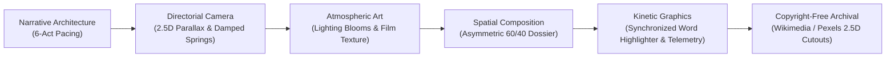
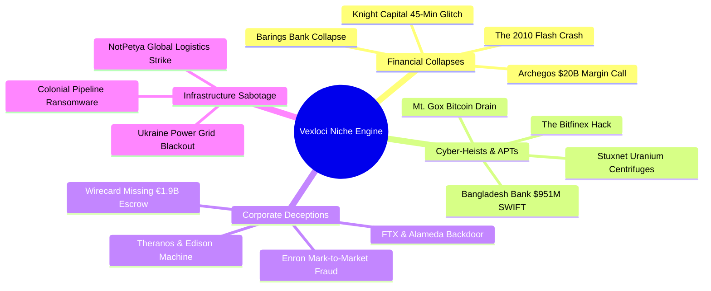
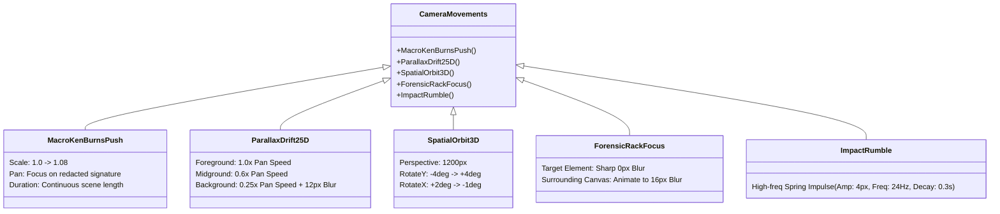
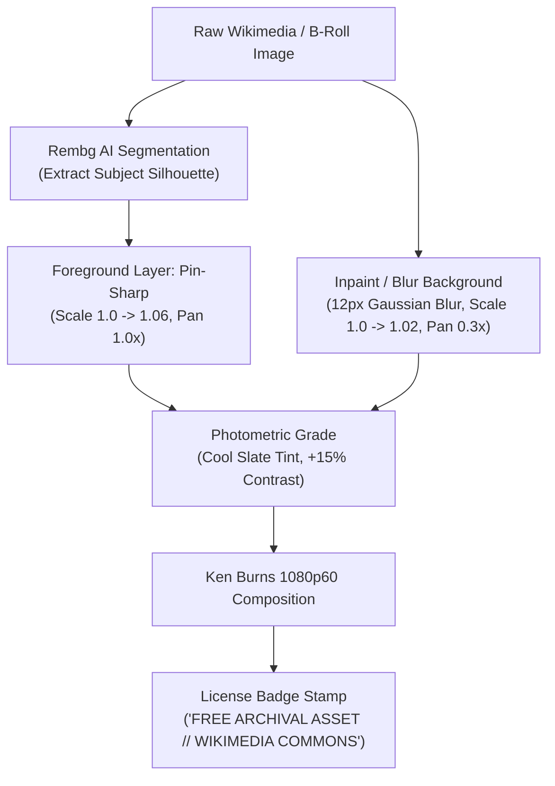

# VISUAL PRODUCTION SPECIFICATION: 8–12 MINUTE FORENSIC DOCUMENTARY ENGINE
**Author:** Vexloci Core Engineering Team  
**Domain:** Headless Forensic Documentary Production (1080p30 / 4K)  
**Target Duration:** 480 – 720 Seconds (8 – 12 Minutes)  
**Theoretical Baseline:** Cognitive Load Theory, Dual-Coding Theory, Kinesthetic Motion Grammar, and YouTube Retention Psychology  

---

## 1. Executive Summary & Cognitive Thesis

To hold viewer retention across an **8-to-12 minute investigative documentary** without relying on talking-head footage, the video engine must satisfy the **3.5-Second Visual Event Horizon**:
*The human visual cortex habituates to unvarying visual stimuli within 2.5 to 3.5 seconds. If a frame remains static beyond 4.0 seconds, perceived pacing collapses, and viewer drop-off escalates.*

Every visual frame in Vexloci must operate as a dynamic, layered intelligence workstation governed by five immutable pillars:



---

## 1.1 The Topic-Agnostic Niche Architecture (Generalizing Beyond a Single Case)

Vexloci is not an isolated one-off script generator; it is a **universal, topic-agnostic documentary compiler** for the high-stakes forensic investigative niche. The engine accepts **ANY topic string or research brief** across four core sub-genres:



### Universal Topic-to-Template Mapping Matrix
No matter the topic, the engine maps narrative beats to the 10 Parametric Master Templates:

| Narrative Beat | Forensic Function | Knight Capital ($440M) | Wirecard (€1.9B) | Mt. Gox (850k BTC) | Bangladesh Bank ($951M) |
| :--- | :--- | :--- | :--- | :--- | :--- |
| **Beat 1: The Anomaly** | `ForensicDocument` | SEC Action 3-15570 | KPMG Audit Rejection | Tokyo Court Filing | Fedwire Fraud Notice |
| **Beat 2: Archival Context** | `ArchivalFootage` | NYSE Floor Opening Bell | Aschheim HQ Building | Shibuya Headquarters | Motijheel 31-Story HQ |
| **Beat 3: Technical Flaw** | `TerminalReplay` | `route_exec.sh` Power Peg | Wirecard Escrow Ledger | Murch/Willy Bot Script | `evtdiag.exe` NOP Patch |
| **Beat 4: Structural Model** | `SystemBlueprint` | SMARS Routing Engine | Third-Party Acquirer Mesh | Hot/Cold Wallet Architecture | SAA Oracle DB Pipeline |
| **Beat 5: Quantitative Collapse** | `MarketCrashChart` | KCG Stock -75% Plunge | Wirecard Stock Collapse | Bitcoin Price Flash Crash | Fedwire Outflow Chart |
| **Beat 6: Contagion/Geography** | `GeoIpTraceMap` | Chicago $\to$ Jersey City | Munich $\to$ Manila $\to$ Dubai | Tokyo $\to$ London $\to$ Moscow | Pyongyang $\to$ Dhaka $\to$ NY |
| **Beat 7: Laundering/Entity Web** | `NetworkTopology` | Market Center Liquidity Pool | Al Alam & Centurion Shells | Mixer & Tumbler Clusters | Centurytex $\to$ Solaire VIP |
| **Beat 8: Intercepted Comms** | `CommsIntercept` | Trader Panic Emails | Markus Braun WhatsApps | Mark Karpeles IRC Chat | Swift Confirmation Fax |
| **Beat 9: Countdowns/Races** | `ChronoTickingClock`| 45-Minute Kill Switch | 48-Hour Escrow Deadline | 12-Hour Cold Wallet Drain | 20:15 EST Friday Night |
| **Beat 10: The Disposition** | `SplitAutopsy` | Firm Capital Depletion | €1.9B Non-Existent Assets | 650k Stolen vs 200k Found | $951M Targeted vs $81M Out |

---

## 2. Phase 1: Script Writing & Long-Form Narrative Architecture (8–12 Minutes)

### 2.1 The Universal 6-Act Investigative Model
An 8–12 minute documentary (1,200 to 1,650 spoken words at 145–155 WPM) structures any investigative topic into **6 distinct movements**:

```
Tension Level (1-10)
10 |                                    [Act 5: Climax]
 8 |          [Act 2: Breach]                 /\
 6 |  [Act 1]   /\            [Act 4: Contagion]  \
 4 |    /\     /  \   [Act 3]      /\              \   [Act 6: Autopsy]
 2 | __/  \___/    \_/\_/\________/  \______________\________/
 0 +------------------------------------------------------------> Time (0 - 12 Min)
```

| Act | Timestamp (10m Target) | Narrative Purpose | Cognitive Pacing & Visual Style |
| :--- | :--- | :--- | :--- |
| **Act 1: The Cold Open & Hook** | 0:00 – 1:30 (90s) | Present the catastrophic anomaly immediately. The \$951M transfer, the dead printer, the missing logs. State the dramatic thesis: *One typo prevented the total collapse of the banking system.* | Rapid cuts (3.0s – 4.5s per shot). Ken Burns push-ins on redacted cables, flashing red warning telemetry. |
| **Act 2: The Physical & Digital Infiltration** | 1:30 – 3:15 (105s) | Establish the forensic setting. Dhaka, Bangladesh. The physical Motijheel headquarters. The \$10 unmanaged hub and the `Resum.zip` spear-phishing attack. | 2.5D architectural parallax photos, terminal packet traces, floorplan blueprints. |
| **Act 3: The Assembly Patch (Forensic Deep Dive)** | 3:15 – 5:30 (135s) | Reverse-engineering the malware (`evtdiag.exe`). Byte-level memory patching of Oracle DLLs at offset `0x0041A28F` with `NOP NOP` (`90 90`). | Live code disassembly terminals, animated binary hex editors, memory architecture diagrams. |
| **Act 4: The Strike Night & Transatlantic Contagion** | 5:30 – 7:45 (135s) | The execution phase during Chinese New Year. 35 payment orders hitting the NY Federal Reserve. The typo (`Shalika Fandation`) and the OFAC sanctions freeze. | Global 3D orthographic arc maps, split-screen bank transfer ledgers, ticking countdown clocks. |
| **Act 5: The Manila Casino Laundering Maze** | 7:45 – 9:45 (120s) | Tracking the escaping \$81M. Consolidation through RCBC Jupiter, FX conversion via Philrem, and dispersal into VIP junkets at Solaire and Midas casinos. | Force-directed network topology graphs, shell company flowcharts, money-bag flight paths. |
| **Act 6: Forensic Autopsy & Legacy** | 9:45 – 11:30 (105s) | Accounting for every dollar. The unrecovered \$65.75M. FBI indictments against Lazarus Group. Systemic vulnerabilities in the global financial mesh. | Dual-column autopsy matrices, final red verdict stamps, slow cinematic pull-outs. |

### 2.2 Script Pacing & Semantic Annotation Grammar
The script generated in `stage1_research.py` must embed structured visual directives directly into each scene node:

```json
{
  "sceneId": "act3_scene04_hex_patch",
  "act": 3,
  "targetDurationSec": 18.5,
  "cameraMove": "MACRO_PUSH_IN",
  "cameraFocalPoint": {"x": 0.42, "y": 0.55},
  "layoutArchetype": "SPLIT_DOSSIER_60_40",
  "primaryVisual": {
    "type": "terminal_replay",
    "binaryTarget": "liboradb.dll",
    "hexOffset": "0x0041A28F",
    "opcodes": "75 04 -> 90 90"
  },
  "secondaryVisual": {
    "type": "telemetry_stack",
    "metrics": ["OFFSET: 0x0041A28F", "INSTRUCTION: NOP (0x90)", "DB CHECKSUM: BYPASSED"]
  },
  "highlightPhrases": ["memory-patching", "offset double-zero", "no-operation"],
  "archivalBackdrop": "wikimedia_bb_motijheel_hq.jpg"
}
```

---

## 3. Phase 2: Directorial Language & Cinematic Motion Grammar

### 3.1 Camera Motion Physics
Linear camera movements feel robotic and corporate. All camera rigs in Vexloci must utilize **damped spring physics** or **cubic-bezier acceleration curves**:

$$\text{Scale}(t) = 1.0 + \Delta S \cdot \left(1 - e^{-\zeta \omega_n t} \cos(\omega_d t)\right)$$

- **Spring Parameters:**
  - Angular Frequency ($\omega_n$): $12.0$
  - Damping Ratio ($\zeta$): $0.85$ (slightly underdamped for tactile physical settle)
  - Scale Delta ($\Delta S$): $0.06$ to $0.10$ over a 10-second shot.

### 3.2 The 5 Canonical Camera Archetypes



1. **The Macro Ken Burns Push-In:** Slow, relentless forward crawl ($1.00 \to 1.08$ scale) anchored directly onto the focal evidence (e.g. the typo `"Shalika Fandation"` or the assembly instruction).
2. **The 2.5D Parallax Drift:** Slices images via AI segmentation (`rembg`):
   - Foreground (e.g. Bangladesh Bank building or official portrait) stays pin-sharp and moves at $1.0\times$ velocity.
   - Background (e.g. city skyline or bank lobby) blurs by $12\text{px}$ and moves at $0.3\times$ velocity, creating tangible stereoscopic depth.
3. **The Spatial Orbit / 3D Tilt:** Cards and documents are placed inside a CSS `perspective: 1400px` container, gently revolving on the Y-axis ($-3.5^\circ \to +3.5^\circ$) to eliminate the flat "cardboard" feel.
4. **The Forensic Rack Focus:** When highlighting a specific paragraph or telemetry metric, the rest of the canvas blurs progressively from $0\text{px} \to 14\text{px}$ over 18 frames, isolating viewer gaze.
5. **The Impact Micro-Rumble:** On decisive events (e.g., rubber stamp slamming "SANCTIONS FREEZE" or wire rejection), trigger a 9-frame decaying displacement oscillation ($[-4\text{px}, +3\text{px}, -2\text{px}, +1\text{px}, 0]$) to deliver physical weight.

---

## 4. Phase 3: Art Direction, Color Theory & Visual Tone

### 4.1 Palette Hierarchy (Dark Forensic Terminal)
The color system reflects an intelligence agency forensic workstation: high-contrast dark backgrounds with surgical, information-dense accent colors.

```
+--------------------------------------------------------------------------+
|  CANVAS BASE: Void Black (#080A0F)                                       |
|  +--------------------------------------------------------------------+  |
|  |  CARD SURFACE: Obsidian Glass (#11151F, 88% Opacity + 20px Backdrop)|  |
|  |  BORDER / GRID: Structural Steel (#1E2536, 1px Solid)              |  |
|  |                                                                    |  |
|  |  ACCENT CYAN (#00F5D4): Active data packets, Whisper word glow     |  |
|  |  ACCENT AMBER (#F59E0B): Anomalies, unverified wires, warnings    |  |
|  |  ACCENT CRIMSON (#FF2A54): Malicious opcodes, permanent loss, NOP  |  |
|  |  TEXT PRIMARY (#F1F5F9): High-contrast clean white headings         |  |
|  |  TEXT MUTED (#94A3B8): Secondary telemetry and captions           |  |
|  +--------------------------------------------------------------------+  |
+--------------------------------------------------------------------------+
```

### 4.2 Lighting & Atmospheric Shaders
1. **Volumetric Radial Bloom:** Placed centrally behind the active card:
   `radial-gradient(circle 600px at 50% 45%, rgba(0, 245, 212, 0.08) 0%, rgba(8, 10, 15, 0) 70%)`.
2. **Photorealistic Film Grain:** A permanent overlay of procedural monochromatic noise (SVG turbulence filter with `feTurbulence baseFrequency="0.75" numOctaves="3"` at $3.5\%$ opacity) to eliminate digital color banding.
3. **Peripheral Optical Vignette:** Soft elliptical vignette darkening screen perimeters by $45\%$, pulling attention toward the center $70\%$ bounding box.
4. **Tactical Registration Hairlines:** Subtle 6% opacity coordinate grids (`LAT/LON`, `CH-01`, `UTC+00:00`) and corner registration crosses (`+`) at $X=48\text{px}, Y=36\text{px}$ to establish an authentic forensic terminal aesthetic.

---

## 5. Phase 4: Composition, Spatial Geometry & Element Placement

### 5.1 The 4 Primary Layout Archetypes (1920x1080)

```
ARCHETYPE A: 60/40 Asymmetric Dossier          ARCHETYPE B: Full-Bleed 3D Geo-Map
+-----------------------+--------------+       +------------------------------------+
|                       |  TELEMETRY   |       |   [Pyongyang]                      |
|   PRIMARY EVIDENCE    |  METRICS     |       |        \                           |
|   DOSSIER CARD        |  TIMESTAMP   |       |         \--> [Dhaka]               |
|   (Ken Burns Zoom)    |  EXTRACT     |       |                 \--> [NY Fed]      |
|                       |  PROVENANCE  |       |                        \           |
|   Width: 1140px       |  Width: 580px|       |                         v [Manila] |
+-----------------------+--------------+       +------------------------------------+
|  [ SUBTITLES: Centered Y=920px ]     |       |  [ SUBTITLES: Centered Y=920px ]   |
+--------------------------------------+       +------------------------------------+

ARCHETYPE C: 50/50 Autopsy Matrix              ARCHETYPE D: 2.5D Archival Cinema
+------------------+-------------------+       +------------------------------------+
| TARGETED CAPITAL | DISPOSITION MATRIX|       |   [ HISTORICAL ARCHIVE FOOTAGE ]   |
| $951,000,000     | $850M Sanctions   |       |   Ken Burns ZoomPan + 2.5D Matting |
| [Red Bar Chart]  | $20M Typo Stop    |       |   +----------------------------+   |
|                  | $81M Laundered    |       |   | EXHIBIT DOSSIER OVERLAY    |   |
|                  | $65.75M Lost      |       |   | Source: Wikimedia Commons  |   |
+------------------+-------------------+       +---+----------------------------+---+
```

### 5.2 Safe Margins & Typographic Scale
- **Horizontal Safe Zone:** $96\text{px}$ ($5\%$)
- **Vertical Safe Zone:** $72\text{px}$ ($6.6\%$)
- **Subtitle Strip:** Positioned at $Y = 920\text{px}$, centered horizontally, maximum width $1180\text{px}$. Words render in clean sans-serif (`Inter`, $36\text{px}$, weight 700), with the currently active Whisper word illuminated in Accent Cyan (`#00F5D4`) with a $12\text{px}$ soft text shadow.

---

## 6. Phase 5: Custom Animated Graphic Elements & Motion Engine

The Vexloci motion engine hardcodes 7 distinct procedural graphic systems:

### 6.1 The Animated Kinetic Highlighter
- **Behavior:** Reads exact start and end timestamps of keywords from `03_words.json`.
- **Motion:** An SVG `<rect>` behind the text draws from `width: 0%` to `width: 100%` with cubic easing ($0.22, 1, 0.36, 1$) across the exact duration of the spoken phrase.
- **Color:** Semi-translucent forensic amber (`rgba(245, 158, 11, 0.32)`) or tactical cyan (`rgba(0, 245, 212, 0.28)`).

### 6.2 Physical Rubber Stamp Decal
- **Behavior:** Fires on decisive conclusions (e.g. `"SANCTIONS FREEZE"`, `"UNRECOVERED"`).
- **Physics:** Scale drops from $1.6 \to 1.0$ in 6 frames, rotation settles from $-8^\circ \to -4^\circ$ with spring rebound. Triggers a synchronized low-frequency stamp audio impulse and micro camera rumble.
- **Styling:** Distressed grunge border ($3\text{px}$ double-border), bold uppercase monospace font, $85\%$ opacity with slight ink bleed.

### 6.3 Real-Time Disassembly & Assembly Replay
- **Behavior:** Displays memory buffers, opcode hooks, and command-line execution.
- **Motion:** Typing speed matches narration cadence (1 character per 25ms). Active line displays a blinking cursor (`_`, $2\text{Hz}$). Successfully patched instructions transition from slate (`#94A3B8`) to glowing crimson (`#FF2A54`) with an inline comment: `// 75 04 -> 90 90 (NOP NOP)`.

### 6.4 Dynamic Exponential Financial Ticker
- **Behavior:** Numerical values (e.g. `"$951,000,000"`, `"$81,000,000"`) roll upward smoothly using exponential deceleration:
  $$V(t) = V_{\text{target}} \cdot \left(1 - (1 - t/T)^3\right)$$
- **Format:** Always formatted with commas, currency prefixes, and color-coded status badges (`HALTED`, `SETTLED`, `LOST`).

### 6.5 Interactive 3D Cartographic Arc Routing
- **Behavior:** Visualizes global cyber routes across continents.
- **Motion:** Cities render as pulsing radar circles. Flight paths render as animated cubic Bezier curves using SVG `strokeDasharray` and `strokeDashoffset`:
  $$\text{Path: } P_0(\text{Pyongyang}) \to P_1(\text{Dhaka}) \to P_2(\text{New York}) \to P_3(\text{Manila})$$
- Packets travel along the curve as bright glowing cyan dots leaving fading particle trails.

### 6.6 Force-Directed Laundering Topology Graph
- **Behavior:** Node-and-link graph tracking money laundering paths (Central Bank $\to$ RCBC Accounts $\to$ Centurytex $\to$ Philrem $\to$ Solaire Casino VIP).
- **Motion:** Nodes spawn with expanding shockwaves. Links pulse in sequential order as the narrator explains each step of the consolidation. Compromised nodes turn crimson; neutral institutions remain slate.

---

## 7. Phase 6: Copyright-Free Archival Media Pipeline

To keep all media legal, copyright-free, and high-fidelity across an 8–12 minute runtime:

### 7.1 Automated Archival Source Hierarchy
1. **Wikimedia Commons API:** Primary source for verified historical buildings, government agency emblems, court filings, and executive mugshots (Public Domain, CC-BY-SA, CC0).
2. **Internet Archive (archive.org):** Public Domain historical footage, news broadcasts, and financial newsreels.
3. **Pexels / Pixabay Video API:** CC0 high-definition background b-roll for conceptual sequences (datacenter server racks, currency counting machines, bank lobbies, night city skylines).
4. **SEC / Department of Justice / Federal Reserve Repositories:** Official government indictments and exhibits (100% Public Domain US Gov works).

### 7.2 The 2.5D Matting & Motion Pipeline



---

## 8. Phase 7: Engine Implementation Blueprint (Hardcoding into Vexloci)

### 8.1 Schema Expansion (`src/schemas/timeline.schema.ts`)
Add dedicated types for the 4 layout archetypes, camera spring dampening, and 7 procedural graphic systems.

### 8.2 Research Stage Scaling (`pipeline/stage1_research.py`)
Scale script compilation from 7 short scenes (60s) up to **24–36 scenes** covering the full 8–12 minute 6-act narrative arc. Each scene is generated with exact visual archetype bindings, camera motion coordinates, and keyword highlight targets.

### 8.3 Asset & B-Roll Resolver (`pipeline/stage4_assets.py`)
Automate fetching of both high-res Wikimedia historical stills and Pexels/Pixabay CC0 ambient b-roll clips, running background 2.5D layer separation via `rembg`.

### 8.4 Remotion Component Expansion (`src/components/`)
Upgrade each of the 10 master templates with the 3.5-second visual event horizon rules, organic camera springs, and kinetic highlights.

---

## 9. Conclusion & Execution Sequence

By hardcoding this visual production specification into Vexloci, every generated documentary will automatically exhibit the visual polish, kinetic pacing, and information density of premier investigative YouTube channels—retaining viewer engagement from the opening anomaly hook to the final forensic autopsy.
